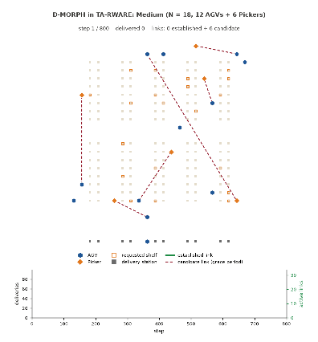

# D-MORPH: Decentralised Self-Organising Multi-Robot Task Allocation via Neuroplasticity-Inspired Adaptive Topology

[](https://www.python.org/)
[](LICENSE)
[](https://cyber-physical-systems-lab.github.io/D-MORPH/)

D-MORPH is a **training-free, fully decentralised** coordination mechanism for heterogeneous multi-robot teams,
inspired by neuroplasticity. Each robot learns **whom to work with** on its own, online, while the team is working:
it keeps its own partner preferences and links and rewires them with biologically grounded plasticity rules, using
only what it observes itself. No central coordinator, no shared state, no message exchange, no task or cost model,
no bidding and no offline training are required.

<p align="center"></p>

*D-MORPH in the [TA-RWARE](https://github.com/uoe-agents/task-assignment-robotic-warehouse) warehouse
(12 AGVs, 6 Pickers). Green: established links; red dashed: candidate links still in their grace period.
All figures and videos: [project page](https://cyber-physical-systems-lab.github.io/D-MORPH/).*

## Key idea

Multi-robot coordination usually either fixes who works with whom by a hand-designed rule (the nearest robot,
robots within a radius), negotiates it through bids over a task cost model, or learns communication end-to-end with
offline multi-agent reinforcement learning. [MORPH](https://github.com/Cyber-physical-Systems-Lab/morph_v2) showed
that a coordination graph can instead **self-organise online** under plasticity rules, but it keeps the graph as one
shared matrix, i.e. a central coordinator. D-MORPH removes the coordinator: every robot owns its row of the graph and
updates it from its own target, the robots co-assigned with it, the requests it sends and receives, and its own
reward. Nothing in the update reads another robot's state.

| Property | Proximity rule | Learned comm (MARL) | MORPH | D-MORPH |
|---|:-:|:-:|:-:|:-:|
| Fully decentralised (no shared state or coordinator) | ✓ | partial | ✗ | ✓ |
| No offline training | ✓ | ✗ | ✓ | ✓ |
| Links formed without sensing other robots' positions | ✗ | ✓ | ✓ | ✓ |
| Adapts online to shifts in the task distribution | ✗ | partial | ✓ | ✓ |
| Persistent memory of good partners | ✗ | ✓ | ✓ | ✓ |
| Works from step 0 in any environment | ✓ | ✗ | ✓ | ✓ |

## Neuroplasticity mechanisms

| Rule | Biological basis | Role in D-MORPH |
|---|---|---|
| R1 synaptic | Hebbian plasticity, reward-modulated (dopamine-gated) potentiation | Strengthen preferences for robots that share recent targets; extra credit when a jointly served task is completed |
| R2 homeostatic | Synaptic scaling | Keep each robot's number of links near a target, so the graph stays sparse |
| R3 structural | Synaptogenesis and pruning | Prune weak links after a grace period; form links to recent co-workers and to robots that were just requested (anticipatory formation) |
| R4 metaplastic | BCM sliding threshold, neuromodulation | Over-potentiated links decay faster; explore new links when the robot's own performance drops, consolidate when it is high |

The same rules work for any team whose members must pair up for tasks and can observe what they are working on and
whether it succeeded; TA-RWARE is the benchmark used in the paper (see [Porting D-MORPH](#porting-d-morph-to-another-simulator-or-task)).

## Results in brief

TA-RWARE, 20 seeds per condition, 800 steps per episode (full tables: [`docs/results.md`](docs/results.md)).

| Fleet (AGVs + Pickers) | D-MORPH deliveries | Full Graph deliveries | D-MORPH / Full Graph | D-MORPH active links (% of pairs) |
|---|---|---|---|---|
| Tiny (5 + 3)   | 56.8  | 55.4 | 103% | 6.6 (23%) |
| Small (8 + 4)  | 66.0  | 64.6 | 102% | 11.4 (17%) |
| Medium (12 + 6) | 90.7 | 84.2 | 108% | 17.6 (12%) |
| Large (16 + 8) | 104.3 | 99.2 | 105% | 23.5 (9%) |

Under a package location shift (demand alternates between the upper and lower half of the warehouse every 400
steps), D-MORPH lost the fewest deliveries between repeated visits to the same half: −0.12 deliveries per phase at
Medium (other baselines −3.20 to −5.70; Random-Sparse (fixed) −0.38 only because it had almost stopped delivering)
and −1.40 at Large (baselines −1.65 to −4.38); no single difference passed the Bonferroni correction. In TA-RWARE the partner chosen by preference differs from the nearest available robot in
under 1.2% of requests, so the learned structure changes few allocation decisions; see the paper's discussion.

## How D-MORPH works

Each robot `i` holds one row of `W` and `A` (a dictionary over the other robots) and changes only that row. In
detail, the four rules above are:

| Rule | What robot `i` does every step (R3: every `k` steps) |
|---|---|
| R1 synaptic | decays `w_i[j]` and strengthens it in proportion to the share of its recent targets shared with `j`; adds completion credit when a mission it served with `j` is delivered |
| R2 homeostatic | raises or lowers its readiness to form links to keep its number of links near a target |
| R3 structural | prunes links whose preference fell below a threshold (after a 20-step grace period) and forms a link to its best candidate (recent co-assignment plus the robot it was proposed) |
| R4 metaplastic | BCM sliding threshold (over-potentiated links decay faster) and neuromodulation from its own outcomes (consolidate when above expectation, explore when below) |

Allocation uses the preferences as follows: the oldest pending task goes to the nearest available robot `i`;
`i` requests the available robot `j` of the complementary role with the highest `w_i[j]` (the nearest if tied);
`j` accepts with probability `0.25 + 0.75 w_j[i]`; a refused request is retried at the next step.

## Repository layout

```
dmorph/            the method
  core.py          DMORPH: per-robot preferences and links, R1-R4, completion credit
  allocation.py    select_partner() and accepts(): how preferences enter allocation
  params.py        the paper's parameters (identical at every fleet size)
experiments/       everything needed to reproduce the paper
  harness.py       one TA-RWARE episode with D-MORPH or a baseline (allocation, AGV mission controller, demand shift)
  config.py        seeds, fleet sizes, horizons, baselines, ablations
  morph.py         centralised MORPH (baseline)
  signals.py       TA-RWARE observation helpers (targets, co-assignment, proximity) used by the baselines
  run.py           runs the five experiments -> results/*.json
  analysis.py      statistics, tables and figures -> docs/
scripts/
  run_dmorph.py    run one episode and print what happened
  make_videos.py   render the supplementary videos -> docs/videos/
results/           one file per experiment: scale, frontier, ablation, shift, emergent (.json)
docs/              project page (index.html), results.md, figures/, videos/, tables/
```

## Installation

Python 3.11. TA-RWARE is installed from GitHub.

```bash
git clone https://github.com/Cyber-physical-Systems-Lab/D-MORPH.git && cd D-MORPH
python -m venv .venv && source .venv/bin/activate      # or: conda create -n dmorph python=3.11
pip install -r requirements.txt
```

`scripts/make_videos.py` also needs `ffmpeg` on the path.

## Quick start

```bash
python scripts/run_dmorph.py                         # D-MORPH, Medium (18 robots), seed 42, 800 steps
python scripts/run_dmorph.py --scale large --steps 1500
python scripts/run_dmorph.py --method full           # a baseline: full, morph, proximity, tsg, random_fixed, random_step
python scripts/run_dmorph.py --shift --steps 2400    # package location shift
```

```
D-MORPH on TA-RWARE medium (N = 18), seed 42, 800 steps
  deliveries: 90  (every 100 steps: 13, 23, 33, 46, 58, 68, 79, 90)
  active links: mean 17.8 of 153 possible pairs, 22 at the end
  links joining an AGV and a Picker: 21 of 22
  mean preference on links: 0.049
  partner differs from the nearest robot in 0.3% of requests; 73% of requests refused and retried
```

The whole paper (2,200 episodes) runs in about six minutes on 16 cores.

## Reproducing the paper

```bash
python -m experiments.run all --jobs 16     # writes results/{scale,frontier,ablation,shift,emergent}.json
python -m experiments.analysis              # writes docs/figures, docs/tables, docs/results.md
python scripts/make_videos.py               # writes docs/videos
```

| Experiment | Paper | Episodes | Output |
|---|---|---|---|
| `scale` | Table 4, Figure 3 | 7 methods × 4 fleet sizes × 20 seeds, T = 800 | `results/scale.json` |
| `frontier` | Figure 4 | Proximity-r, r = 1…12 × 4 × 20 | `results/frontier.json` |
| `ablation` | Figure 5 | 5 D-MORPH variants × 4 × 20 | `results/ablation.json` |
| `shift` | Table 5, Figure 6 | 7 methods × Medium, Large × 20, T = 2400 | `results/shift.json` |
| `emergent` | Figure 7 | 1 D-MORPH episode, Medium, seed 42, T = 1500 | `results/emergent.json` |

Every episode is deterministic given its seed (TA-RWARE and NumPy are seeded per episode; episodes run in separate
processes), so the results files are reproduced exactly. Each experiment can be run alone, e.g.
`python -m experiments.run shift --jobs 8`. Figure 1 (`docs/figures/fig1_allocation_step`) is a drawing, not a result.

Methods compared (`experiments/config.py`): **Full Graph** (every pair linked), **MORPH** (centralised),
**Proximity-r** (robots within Manhattan distance r, r = 5), **TSG** (robots sharing a current target),
**Random-Sparse (fixed)** and **(per-step)** (random links from all pairs with D-MORPH's link budget and random
preferences, drawn once per episode or every step; a request fails if the chosen robot has no link, the same role,
or is busy), and five D-MORPH ablations.

## Using D-MORPH in your own benchmark

D-MORPH needs four things from a simulator: robot roles, each robot's current target (or task), each robot's own
reward or completion signal, and a place in the allocation step where a robot chooses a partner and the partner
answers. The class does not touch the simulator.

```python
import numpy as np
from dmorph import DMORPH, select_partner, accepts

coord = DMORPH(N=n_robots, n_agv=n_agvs)       # paper parameters; robots 0..n_agv-1 are AGVs, the rest Pickers

for t in range(T):
    # 1) allocation: for the oldest pending task, the nearest available robot i is the primary robot
    candidates = [j for j in free_robots if role[j] != role[i]]
    j = select_partner(coord.W[i], candidates, distance=lambda j: dist_to_task(j, task))
    coord.note_proposal(i, j)                    # both robots observe the request
    if accepts(coord.W[j, i]):                   # j answers with probability 0.25 + 0.75 w_j[i]
        assign(task, i, j)
        coord.note_pair(agv_of(i, j), picker_of(i, j))   # the pair that will be credited on completion
    # (if refused, retry the task at the next step)

    # 2) the simulator steps
    rewards = sim.step(actions)                  # per-robot rewards; an AGV's reward > 0.5 marks a delivery

    # 3) every robot updates its own preferences and links (R1-R4)
    coord.set_rewards(rewards)
    coord.step(targets=[current_target(r) for r in range(n_robots)])   # hashable target per robot, None if idle
```

`coord.W[i]` and `coord.A[i]` are robot `i`'s own preferences and links: in a distributed deployment each robot runs
the update on its own row, using only its own target, co-assigned robots, proposals and reward; nothing in `step`
reads another robot's row. `experiments/harness.py` is a complete, working example of this loop for TA-RWARE.

Options:
- `DMORPH(..., reward='task')` replaces delivery-time pair credit with **end-of-task settlement**: an AGV credits every
  Picker that served its task (pickup and return) when the task ends, a Picker credits the AGV when its own part ends,
  and co-occurrence is by task identity instead of target cell. Pass `task_obs=(tokens, partners)` to `step`
  (each robot's task identifier and directly observed partner; see `_task_obs` in `experiments/harness.py`).
  This is an extension, not used in the paper.
- Any parameter in `dmorph/params.py` can be overridden, e.g. `DMORPH(N, n_agv, decay=0.98)`.

## Porting D-MORPH to another simulator or task

1. **Roles.** D-MORPH assumes two complementary roles that must pair up for a task (AGV and Picker in TA-RWARE).
   For more roles, keep one preference row per robot and restrict `candidates` to the roles a task needs.
2. **Targets or tasks.** `step(targets=...)` treats robots with the same target as co-assigned. Give each robot a
   hashable identifier of what it is working on (a location, a task id). If collaboration is spread over time
   (pickup by one robot, return by another), use `reward='task'` with task identifiers.
3. **Completion.** Call `note_pair(agv, picker)` when a partnership is accepted and pass per-robot rewards to
   `set_rewards`; the AGV's reward above 0.5 marks completion. If your simulator has a different completion event,
   set that robot's reward above 0.5 at that step.
4. **Allocation hook.** Replace your partner choice with `select_partner` and gate the partner's answer with
   `accepts`. Everything else in your allocator (task order, path planning, collision handling) stays as it is.
5. **Parameters.** The paper's parameters were tuned on TA-RWARE development seeds. In a new environment, tune them
   on separate seeds (MORPH's procedure: Optuna TPE over the ranges in `dmorph/params.py`), then freeze them.
6. **When it helps.** Preferences can only change outcomes when several partners are available at once and partners
   of the same role differ. In TA-RWARE one Picker is usually free, so D-MORPH mostly reproduces nearest-partner
   allocation with sparse links; check how often `select_partner` differs from the nearest candidate in your setting.

## Citation

```bibtex
@unpublished{niu2026dmorph,
  author = {Niu, Xuezhi and G{\"u}rd{\"u}r Broo, Didem},
  title  = {{D-MORPH}: Decentralised Self-Organising Multi-Robot Task Allocation via Neuroplasticity-Inspired Adaptive Topology},
  note   = {Manuscript},
  year   = {2026}
}
```

D-MORPH builds on MORPH (Niu and Gürdür Broo, European Conference on Multi-Agent Systems) and is evaluated on
TA-RWARE (Krnjaic et al., 2024). Licence: MIT (`LICENSE`).
